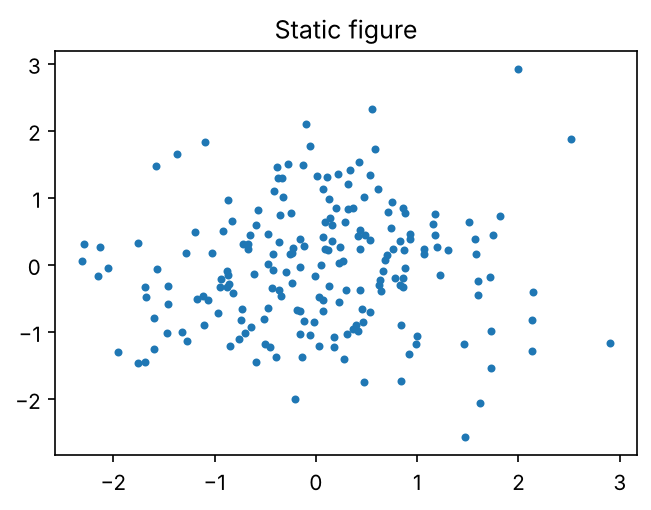

# Text and lists

## Bullet and numbered lists

- First bullet
- Second bullet with **bold**, *italic* and `inline code`
  - Nested bullet
  - Another nested bullet

1. Step one
2. Step two
   a. Sub-step

## Incremental lists and pauses

::: incremental
- Revealed one at a time
- Works in revealjs and beamer
:::

. . .

Text after a pause.

## Links and footnotes

- External link: [Quarto documentation](https://quarto.org/docs/presentations/)
- Autolink: <https://github.com/tlemane/kmindex>
- Internal link to a slide: [code section](#code)
- Citation: kmindex [@lemane2024kmindex]
- A footnote^[Rendered at the bottom of the slide.]

# Media and layout

## Static image

{width=60%}

## Two columns

:::: columns
::: {.column width="50%"}
Left column

- Point A
- Point B
:::

::: {.column width="50%"}
{width=100%}
:::
::::

## Table

| Tool    | Input       | Output        |
|---------|-------------|---------------|
| BCALM2  | FASTA/FASTQ | Unitigs       |
| kmindex | FASTA/FASTQ | k-mer index   |

: A pipe table with caption

## Math

Inline: $p = (1 - e^{-kn/m})^k$

Display:

$$
\hat{n} = -\frac{m}{k} \ln\left(1 - \frac{X}{m}\right)
$$

# Code {#code}

## Static code block

```{.python code-line-numbers="2-3"}
def canonical(kmer: str) -> str:
    rc = kmer[::-1].translate(str.maketrans("ACGT", "TGCA"))
    return min(kmer, rc)
```

Line highlighting applies to revealjs only.

## Executed code with output

```{python}
from collections import Counter

seq = "ACGTACGTTGCA"
k = 3
counts = Counter(seq[i : i + k] for i in range(len(seq) - k + 1))
counts.most_common(3)
```

## Generated figure

```{python}
#| echo: false
#| fig-cap: "Generated at render time (seeded)"
#| fig-width: 6
#| fig-height: 2.8
import matplotlib.pyplot as plt
import numpy as np

rng = np.random.default_rng(42)
plt.hist(rng.poisson(20, 10_000), bins=40)
plt.xlabel("k-mer multiplicity")
plt.ylabel("count")
plt.show()
```

# Extras

## Callout

::: {.callout-note}
## Note
Callouts render in all three formats, with format-specific styling.
:::

## Format-specific content and notes

::: {.content-visible when-format="revealjs"}
Only shown in the HTML slides.
:::

::: {.content-visible when-format="beamer"}
Only shown in the PDF slides.
:::

::: notes
Speaker notes: press `S` in revealjs; they become PowerPoint notes in pptx.
:::

## References

::: {#refs}
:::
